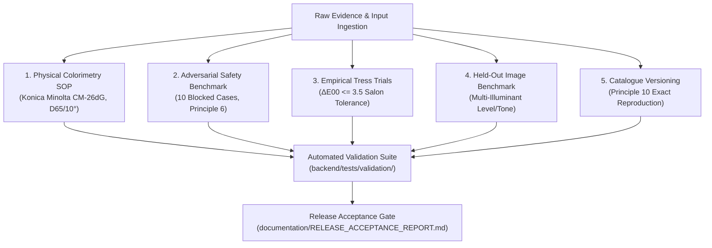

# Validation Protocol & Quality Assurance Standard — Version 1.0
## Nirav Hairstorm: Universal Hair Colour Intelligence Platform

**Document Baseline:** Version 1.0  
**Scope:** Procedures, datasets, tolerances, and release criteria for colourimetric, chemical, and algorithmic validation.  

---

## 1. Overview and Purpose

The Nirav Hairstorm platform establishes a separation between conceptual colour representation (UHCR v1), physical spectrophotometric measurements (CIELAB/CIELCh), and manufacturer chemical formulations. To ensure that software recommendations are safe, reproducible, and verifiable in professional salon practice, all platform modules undergo continuous validation against five core verification protocols.

---

## 2. Five Core Verification Protocols



### Protocol 1: Physical Colorimetry & Spectrophotometry
- **Standard Operating Procedure:** Detailed in [INSTRUMENT_MEASUREMENT_PROTOCOL.md](file:///home/lord-kratos/WORK/D/Nirav%20Hairstorm/documentation/INSTRUMENT_MEASUREMENT_PROTOCOL.md).
- **Dataset:** [physical_swatches.json](file:///home/lord-kratos/WORK/D/Nirav%20Hairstorm/data/validation/physical_swatches.json) (15 benchmark swatches across Levels 2–10).
- **Instrument Standard:** Konica Minolta CM-26dG, $d/8^\circ$ integrating sphere, SCI mode, D65 illuminant, $10^\circ$ standard observer, white ceramic backing tile ($L^* = 98.5$).
- **Instrument Repeatability:** $\Delta E_{00} \le 0.40$ on triplicate measurements.
- **Mathematical Invariant:** $C^* = \sqrt{a^{*2} + b^{*2}}$ and $h^\circ = \text{atan2}(b^*, a^*)$ verified within 0.05.

### Protocol 2: Safety & Adversarial Blocked-Case Verification
- **Dataset:** [safety_blocked_cases.json](file:///home/lord-kratos/WORK/D/Nirav%20Hairstorm/data/validation/safety_blocked_cases.json) (10 adversarial scenarios).
- **Acceptance Gate:** 100% rejection rate. Unsafe inputs MUST produce `BLOCKED` status with zero executable stages.
- **Covered Scenarios:**
  1. PPD/Oxidative allergy history (`SAFETY_ALLERGY_KNOWN_HISTORY`).
  2. Active scalp lesions and broken tissue (`SAFETY_SCALP_INTEGRITY`).
  3. Henna / metallic salts treated hair + persulfate bleach (`SAFETY_HENNA_METALLIC_SALTS`).
  4. Sodium hydroxide (lye) relaxer + decolorizer (`SAFETY_SODIUM_HYDROXIDE_BLEACH`).
  5. Severely damaged cortex + oxidative lifting (`SAFETY_SEVERELY_DAMAGED_FIBER`).
  6. Blondor on-scalp developer exceeding 6% / 20 Vol (`SAFETY_BLONDOR_SCALP_MAX_6PCT`).
  7. Blondor Base Breaker mixed with WellaPlex (`SAFETY_BLONDOR_BB_NO_WELLAPLEX`).
  8. Magma direct on-scalp contact (`SAFETY_MAGMA_ON_SCALP`).
  9. Artificial dark colour lift attempt with permanent tint alone ("Color does not lift color").
  10. Principle 6 violation: Execution attempt against unverified catalogue (`CatalogueStatusEnum.DRAFT`).

### Protocol 3: Empirical Formulation Outcome Verification
- **Dataset:** [formulation_outcomes.json](file:///home/lord-kratos/WORK/D/Nirav%20Hairstorm/data/validation/formulation_outcomes.json) (5 salon laboratory tress trials).
- **Acceptance Threshold:** $\Delta E_{00} \le 3.5$ between empirical dyed tress and target swatch under CIEDE2000 (Sharma 2005).
- **Chemical Verification:**
  - 2-level lift uses 9% (30 Vol) developer.
  - 3-level lift uses 12% (40 Vol) developer.
  - White hair coverage ($\ge 50\%$) mandates 1:1 Pure Natural root base addition at target level.

### Protocol 4: Held-Out Image Classification Benchmark
- **Dataset:** [image_validation_benchmarks.json](file:///home/lord-kratos/WORK/D/Nirav%20Hairstorm/data/validation/image_validation_benchmarks.json) (20 standardized hair tresses, 60 evaluated regions).
- **Illuminants Tested:** D65 Controlled Daylight, 3000K Warm Incandescent, 4000K Salon Fluorescent.
- **Reference Card Presence:** SpyderCHECKR / ColorChecker present vs. absent.
- **Accuracy Gates:**
  - Depth classification accuracy: $\ge 90\%$ exact integer level; 100% within $\pm 1$ level.
  - Primary undertone classification accuracy: $\ge 85\%$.
  - Continuous confidence score exposed in $[0, 1]$ range; colourist confirmation required.

### Protocol 5: Catalogue Versioning & Historical Reproducibility
- **Requirement:** Principle 10 — Any formulation generated in the past must be bitwise reproducible when re-evaluated against the exact historical catalogue version and rule engine.
- **Test Procedure:** Automated test `test_principle_10_exact_historical_reproducibility` verifies identical stage generation, development times, mixing ratios, and shade gram amounts between original v1.0 run and historical re-evaluation after v2.0 catalogue publication.

---

## 3. Automated Test Execution & Auditing

The complete validation protocol is executed via `pytest`:

```bash
# Run entire test suite (202 tests)
.venv/bin/pytest backend/tests/

# Run validation benchmark tests only (21 tests)
.venv/bin/pytest backend/tests/validation/

# Run linter
.venv/bin/ruff check backend/
```

Detailed release evaluation results and gate compliance are published in [RELEASE_ACCEPTANCE_REPORT.md](file:///home/lord-kratos/WORK/D/Nirav%20Hairstorm/documentation/RELEASE_ACCEPTANCE_REPORT.md).
